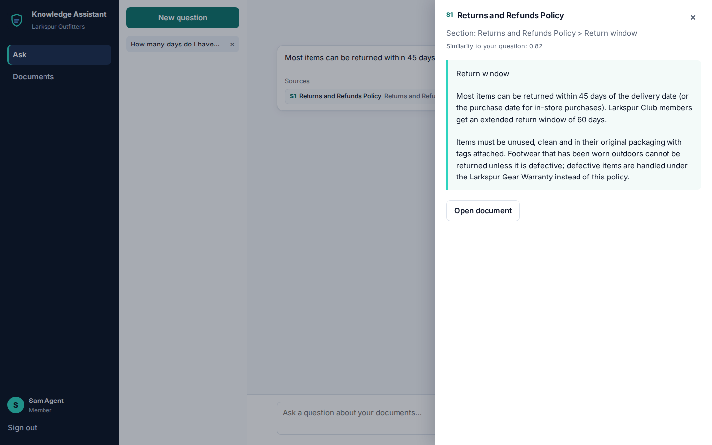
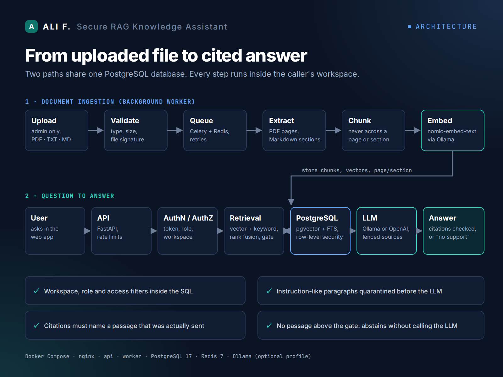
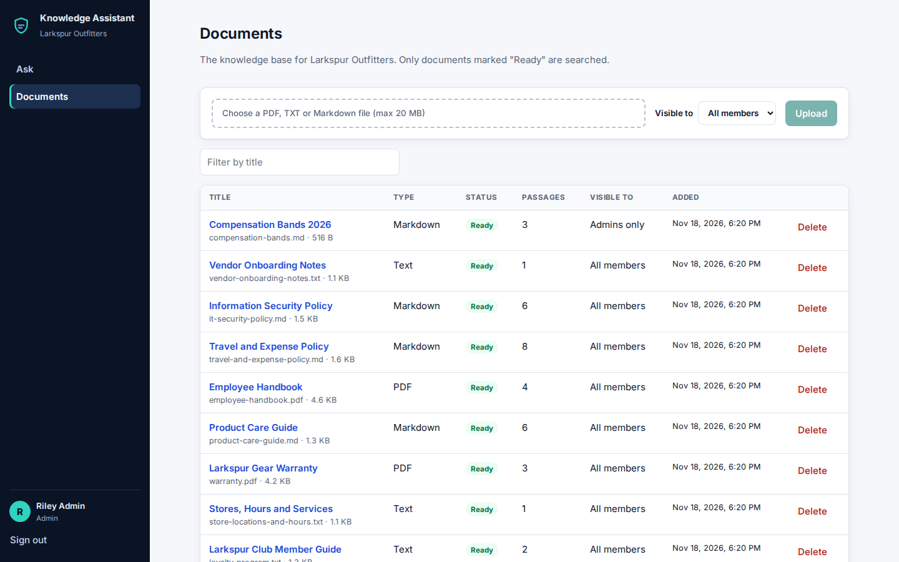
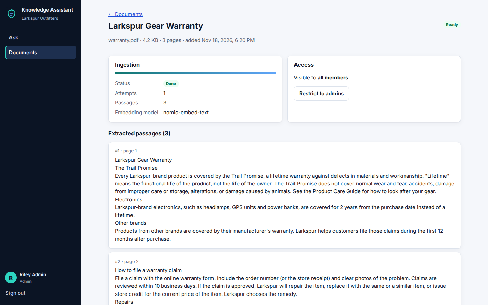
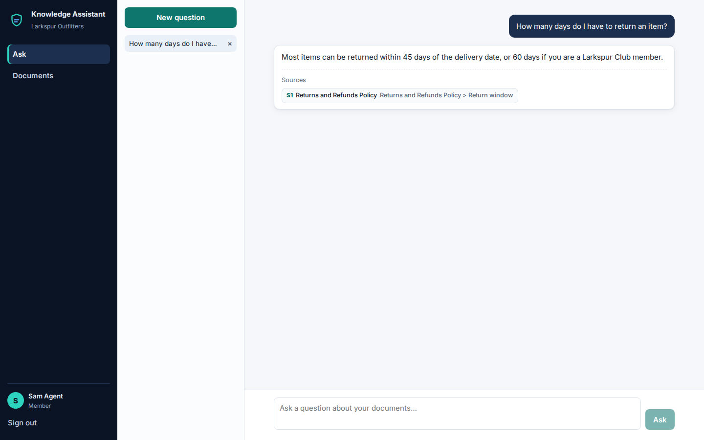
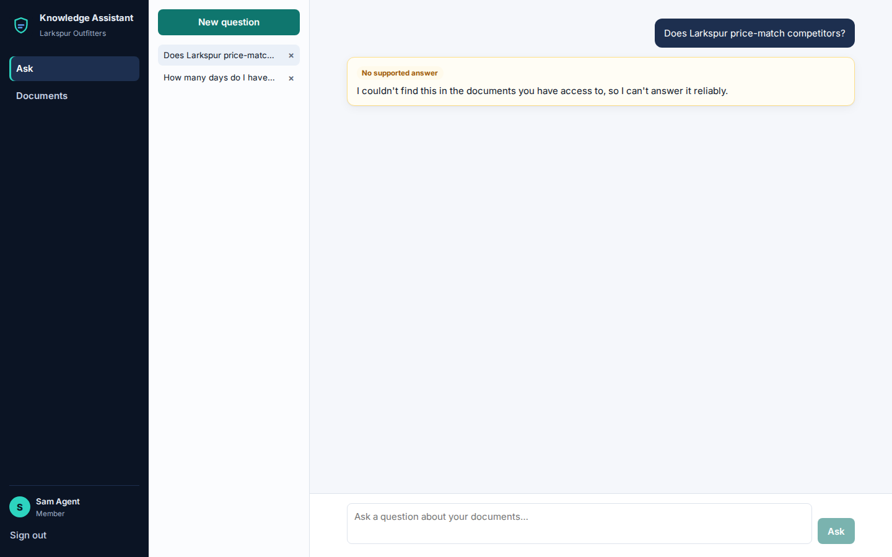

# Secure RAG Knowledge Assistant

[](https://github.com/ali-fakhrabadi/rag-support-chatbot/actions/workflows/ci.yml)


A self-hosted assistant that answers questions from a team's own documents. Every claim cites
the passage it comes from, the assistant says so when the documents don't cover a question,
each workspace only ever sees its own data, and it runs with a local model.



> **Independent reference project.** Built and measured by me on my own lab machines with a
> synthetic document set. It is not client work, and the numbers below come only from the runs
> described in the [benchmark report](docs/evaluation/benchmark-report.md).

## What it does

- **Upload** PDF, TXT and Markdown; ingestion runs in the background with live status, retries
  and clear error messages (encrypted or scanned PDFs, wrong file types).
- **Ask** in plain language and get a short answer with numbered citations; open any citation to
  read the exact passage.
- **Declines** with "No supported answer" instead of guessing when the documents don't answer.
- **Workspaces and roles:** Tenant Admins upload, delete and restrict documents and manage
  members; Members ask questions over the documents they may read.
- **Private by default:** Ollama with `nomic-embed-text` and `llama3.1:8b`; OpenAI is optional.

## Measured results

135 held-out test questions over 15 fictional documents in two workspaces, asked through the
public API with `llama3.1` 8B and `nomic-embed-text` on CPU-only lab machines, scored by
deterministic rules (no model-as-judge).

| Metric | Run 1 (baseline) | Run 2 (after changes) |
|---|---|---|
| Questions passed | 115/135 (85.2 %) | 129/135 (95.6 %) |
| Retrieval Recall@5 | 100 % | 100 % |
| Answer correctness | 83/99 (83.8 %) | 93/99 (93.9 %) |
| Citation accuracy | 98.2 % | 98.2 % |
| Correct abstentions (no answer in the documents) | 26/26 | 26/26 |
| Answerable questions wrongly declined | 2/99 | 3/99 |
| Prompt-injection tests passed | 6/7 | 7/7 |
| Cross-workspace citations | 0 | 0 |
| Admin-only citations shown to members | 0 | 0 |
| Answer time p50 / p95 | 50.5 s / 76.3 s | 49.7 s / 75.9 s |
| Hybrid SQL search p50 | 6 ms | 6 ms |

Run 2 followed two changes made after reading the run 1 failures (paragraph quarantine of
injected instructions, a complete-answer rule), so it is not a clean held-out measurement; both
runs are reported.

Load (k6): search answers in 92 ms p50 for one user and holds about 9 requests per second up to
10 concurrent users (limited by CPU embedding); three users asking at once all got cited
answers, 71 s p50 on the CPU-only model host.

Full tables, load tests, latency, every failed question with the actual answer, and what changed between
the two runs: [docs/evaluation/benchmark-report.md](docs/evaluation/benchmark-report.md).

## How it works



- **API:** FastAPI + Pydantic v2, versioned REST (`/api/v1`) with OpenAPI docs.
- **Data:** PostgreSQL 17 with pgvector (HNSW) and full-text search in one transactional store;
  SQLAlchemy 2 + Alembic.
- **Ingestion:** Celery + Redis; page- and heading-aware chunks so every citation points to one
  page or section.
- **Retrieval:** vector + keyword search fused with reciprocal rank fusion, filtered inside SQL
  by workspace, document access and status, with a calibrated similarity gate.
- **Answers:** JSON-schema output at temperature 0; citations validated against the passages
  that were actually sent; instruction-like paragraphs in documents are quarantined.
- **Isolation:** forced PostgreSQL Row-Level Security under a non-owner database role, plus
  application filters.
- **Web app:** React 19 + TypeScript + Vite behind an unprivileged nginx with a strict CSP.

Details: [architecture](docs/architecture.md), [RAG pipeline](docs/rag-pipeline.md),
[security](docs/security.md), [threat model](docs/threat-model.md).

## Quick start

Needs Docker with Compose and an Ollama server with `nomic-embed-text` and `llama3.1:8b`.

```bash
git clone https://github.com/ali-fakhrabadi/rag-support-chatbot.git
```

```bash
cd rag-support-chatbot && scripts/init-secrets.sh && cp .env.example .env
```

Set `RAG_OLLAMA_BASE_URL` (and `RAG_LLM_MODEL` to the exact tag you pulled) in `.env`, then:

```bash
docker compose up -d --build
```

```bash
docker compose exec api python -m app.cli create-workspace --slug acme --name "Acme" --admin-email admin@acme.example
```

Open <http://127.0.0.1:8080>. More options (bundled Ollama, OpenAI, TLS, backups):
[deployment](docs/deployment.md). API walkthrough: [API examples](docs/api-examples.md).

## Screenshots

| | |
|---|---|
|  |  |
| Documents with ingestion status and access levels | Ingestion facts and the extracted passages |
|  |  |
| An answer with inline citations and sources | Declining a question the documents don't cover |

All screenshots are taken by the browser tests against the running stack with the real models
(fictional documents).

## Tests

| Suite | What | Count |
|---|---|---|
| Backend unit | extraction, chunking, model providers, retrieval fusion, prompts, quarantine, citations, passwords, tokens, settings | 90 |
| Backend integration | API and database against real PostgreSQL + pgvector and Redis: roles, row-level security, isolation, ingestion, chat | 35 |
| Frontend | Vitest + Testing Library: sign-in, documents and upload, chat with citations and the passage drawer, passage text formatting | 26 |
| Browser (Playwright) | the running stack, two workspaces; 4 of them use the real models | 13 |
| Evaluation | labeled questions (dev 24, test 135) | 159 |

Backend line coverage: 93 %.

CI (GitHub Actions) runs lint, types, the backend tests against real PostgreSQL + pgvector and
Redis with a 90 % coverage gate, pip-audit, the frontend checks with `npm audit`, gitleaks over
the full history, Trivy on both images, and the browser tests against the Compose stack.

## Repository layout

```text
backend/    FastAPI app, Celery worker, Alembic migrations, unit + integration tests
frontend/   React + TypeScript app, Vitest tests, nginx config
e2e/        Playwright browser tests against a running deployment
evals/      corpus, 159 labeled questions, seeding, calibration, scoring, report tables
loadtest/   k6 scripts
docs/       architecture, security, threat model, pipeline, deployment, evaluation
```

## Documentation

[Architecture](docs/architecture.md) · [RAG pipeline](docs/rag-pipeline.md) ·
[Security](docs/security.md) · [Threat model](docs/threat-model.md) ·
[Deployment](docs/deployment.md) · [API examples](docs/api-examples.md) ·
[Evaluation methodology](docs/evaluation/evaluation-methodology.md) ·
[Benchmark report](docs/evaluation/benchmark-report.md) ·
[Troubleshooting](docs/troubleshooting.md) · [Limitations](docs/limitations.md) ·
[Changelog](CHANGELOG.md) · [Contributing](CONTRIBUTING.md)

## Limitations

CPU-only answers take tens of seconds; PDF/TXT/Markdown only (no OCR or DOCX); two roles and two
document access levels; prompt-injection quarantine is pattern based. The full list is in
[docs/limitations.md](docs/limitations.md).

## License

[MIT](LICENSE)
