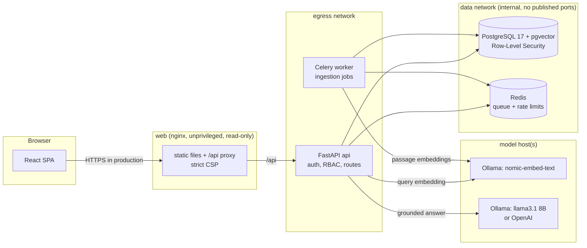

# Architecture

A modular monolith: one FastAPI application, one Celery worker that reuses the same service
code, PostgreSQL with pgvector as the only data store, Redis for the job queue and rate limits,
and a React single-page app served by nginx. Models are reached over HTTP (Ollama by default,
OpenAI optional), so the model host can be the same machine or a separate one.

## Code layout (`backend/app`)

| Package | Responsibility |
| --- | --- |
| `api/v1` | HTTP routes only: request parsing, response models, dependencies |
| `core` | Settings (`RAG_*`), passwords (Argon2id), JWTs, rate limits, errors, JSON logging with redaction, request dependencies that resolve the caller's tenant and role from the database |
| `db` | SQLAlchemy models, engine and the session hook that binds every transaction to one tenant |
| `ingestion` | Upload validation, PDF/TXT/Markdown extraction, normalisation, chunking |
| `providers` | Embedding and LLM clients behind small interfaces (Ollama, OpenAI, deterministic hashing for tests) |
| `rag` | Reciprocal rank fusion, prompt building and quarantine, citation validation |
| `services` | Use cases: auth, tenants and members, documents, ingestion, retrieval, chat, audit |
| `worker.py` | Celery app and the `rag.ingest_document` task |
| `cli.py` | Operator commands: create a workspace, add a user, re-embed a workspace |

## Request flows

**Upload.** An admin posts a file. The API validates name, size, extension and content
signature, stores the bytes in `document_uploads`, creates the `documents` row (`pending`) and an
`ingestion_jobs` row (`queued`) in one transaction, and enqueues the job. If the queue is down
the document is marked failed and the client gets a 503, so nothing is left silently pending.

**Ingestion.** The worker loads the upload, extracts text per PDF page or Markdown heading,
normalises it, cuts it into overlapping chunks that never cross a page or section, embeds them
in batches (reporting progress), and replaces the document's chunks in one transaction. The
stored upload bytes are deleted when the job finishes. Transient model errors are retried three
times with back-off (15, 30, 60 s); permanent errors mark the document failed with a readable
message. Jobs are acknowledged only after they finish, so a crashed worker does not lose them.

**Question.** The API embeds the question, runs a vector search (HNSW, cosine) and a full-text
search (PostgreSQL `tsvector`) restricted to the caller's tenant, ready documents, the current
embedding model and the documents the caller's role may read, fuses both rankings with RRF and
keeps the top passages above the similarity gate. With no passage left it abstains without
calling the model. Otherwise it quarantines instruction-like paragraphs, fences the passages,
asks the model for JSON (`answer`, `citations`, `insufficient_evidence`) at temperature 0, and
validates every citation against the passages it actually sent. Conversation history (last four
messages) is included with citation markers stripped.

## Data model

`tenants`, `users`, `memberships` (role per tenant), `refresh_tokens` (hashed), `documents`,
`document_uploads`, `ingestion_jobs`, `chunks` (text, page, section, `vector(768)`, embedding
model name, generated `tsvector`), `conversations`, `messages` (citations and timing metadata as
JSONB) and `audit_events`. Every tenant-owned table has a `tenant_id` column with forced
Row-Level Security; see [security.md](security.md).

## Deployment shape

`compose.yaml` runs `postgres`, `redis`, a one-shot `migrate`, `api`, `worker` and `web`, plus an
optional `ollama` profile. PostgreSQL and Redis sit on an internal network with no published
ports; only `web` is published, on `127.0.0.1` by default. All application containers run as
non-root users with read-only root filesystems, no Linux capabilities and `no-new-privileges`.
See [deployment.md](deployment.md).

## Why these choices

- **pgvector instead of a separate vector database:** chunks, permissions and tenants live in
  one transactional store, so a permission change or a deletion is visible to search in the
  same commit, and Row-Level Security covers vectors too.
- **Hybrid retrieval:** embeddings find paraphrases; full-text search finds exact names, codes
  and numbers that small embedding models blur. RRF needs no score calibration between the two.
- **Celery for ingestion:** embedding on CPU takes seconds to minutes per document; the API
  stays responsive and jobs survive restarts.
- **Synchronous SQLAlchemy:** the API and the worker share one code path; request concurrency
  comes from uvicorn workers and the thread pool.
